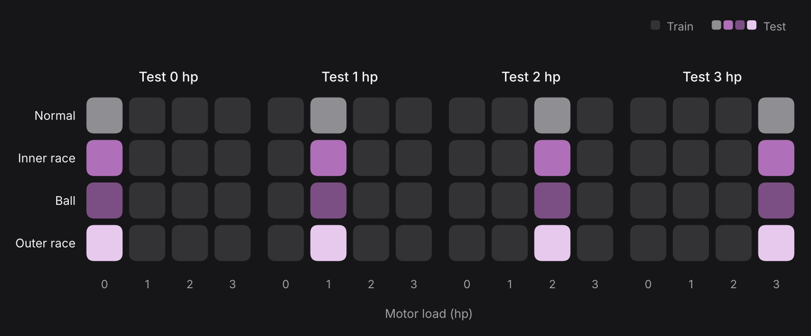

# Machine Condition Intelligence

Bearing fault diagnosis from vibration that keeps working when the load, the noise or the sensor changes.


| | |
|---|---|
| **Unseen sensor** | 0.84 macro-F1 after adaptation, up from 0.31 for the hand-crafted baseline |
| **Heavy noise** | 0.99 macro-F1 at −5 dB, where the baseline falls to 0.40 |
| **Model** | 21,604 parameters, 41 KB once quantised to 8-bit integers |
| **Speed** | 0.04 ms per window on a single CPU thread |

## Why this project

Machine-health systems listen to motors, pumps and fans through accelerometers and flag a failing bearing before it breaks. Models for this task often score close to perfect in the lab and then disappoint in the field. The reason is rarely the model itself. The field is simply different from the lab. The machine runs at another load, the floor is noisy, and the sensor is mounted somewhere else.

This project treats those differences as the real problem. It builds a small vibration model, tests it honestly against each kind of change, and adds only what each change requires.

## The questions

Each stage of the project answers one question, and each question has a test that can fail.

| Question | How it is tested |
|---|---|
| Does it work at a load it has never seen? | Train on three motor loads, test on the fourth |
| Does it work when trained on very little? | Train on one load, test on the other three |
| Does it survive a noisy machine room? | Add noise from 20 dB down to −5 dB signal-to-noise ratio |
| Does it survive a sensor in a new place? | Train on the drive-end sensor, test on the fan-end sensor |
| Does it know when it should not be trusted? | Count drift alarms under each of the changes above |
| Can it run on small hardware? | Export, quantise and compare against the original |

## Data

The data is a subset of the [Case Western Reserve University bearing dataset](https://engineering.case.edu/bearingdatacenter). It has sixteen recordings: four bearing conditions (normal, inner-race fault, ball fault, outer-race fault) at four motor loads (0 to 3 hp). Each recording has two accelerometers sampled at 12 kHz, one at the drive end and one at the fan end. The faults are 0.007 inch across and sit in the drive-end bearing.

Only these sixteen files are downloaded, each verified against a checksum. An audit of every file found that one normal recording also contains a copy of another, so every channel is selected by its recording ID rather than by position.


Each fault makes the bearing ring at its own rate. A defect on the outer race is struck by every passing ball, so its impacts repeat at a frequency set by the bearing's geometry and the shaft speed. The envelope spectrum recovers that rate. Its peaks land on the predicted fault frequencies (BPFI, BSF and BPFO), which confirms both the labels and the physics before any model is trained.

## Evaluation design

A vibration recording is a long, continuous signal, and windows cut from the same recording are near copies of each other. If one recording supplies windows to both training and testing, the test measures memory instead of diagnosis. So every split holds out entire recordings, and a test in `tests/` proves that no recording ever appears on both sides.



Each recording is trimmed to 10 seconds so that no condition dominates, then cut into windows of 2048 samples, about 0.17 seconds. Training windows overlap by 75%, and test windows do not overlap at all. Every score is macro-F1 across the four conditions, which weighs a missed rare fault as heavily as a missed common one.

## Baseline

The first model is the one an experienced vibration engineer would build. Ten features describe each window. Six of them are signal statistics such as RMS and kurtosis, and four measure the envelope energy near each predicted fault frequency. A gradient-boosted tree classifier reads those features.

The baseline sets the bar every other approach has to clear. It also shows where hand-crafted knowledge runs out, because features designed for clean signals degrade quickly once noise or a new sensor changes the signal.

## Model


The network is a small one-dimensional convolutional network that reads the raw vibration window directly. Each part has a reason to be there.

| Stage | Output | Why it is there |
|---|---|---|
| Normalisation | 2048 | Removes each window's offset and loudness, so the model reads shape rather than level. It lives inside the network, so the exported file needs no preprocessing. |
| Frequency filters | 16 × 128 | A wide first layer (kernel 64, stride 8) that learns its own frequency bands. It is the learned counterpart of the band-pass filter chosen by hand for the envelope spectrum. |
| Convolution | 64 × 16 | Three blocks of convolution, batch normalisation, ReLU and max pooling. They learn the impact patterns that tell the faults apart. |
| Pooling | 64 | Averages each channel over time, so a fault is recognised wherever it occurs within the window. |
| Classification | 4 | A linear layer that scores the four conditions. The highest score is the decision. |

Every convolution block uses batch normalisation. That choice is what makes adaptation to a new sensor possible later without retraining.

## Training

Each epoch, two kinds of augmentation are applied to about half of the training windows, each targeting one of the changes the model will meet in the field.

**Noise training** adds white noise at a random signal-to-noise ratio between 20 dB and −5 dB. The model learns to find the fault impacts beneath the noise instead of relying on a clean background.

**Transfer training** passes each window through a random mechanical path, a smooth random equaliser followed by a low-pass filter. A sensor in a different place hears the same bearing through a different path, so the model learns to stop depending on how the signal was filtered on its way to the sensor.

Training runs for 15 epochs with AdamW at a learning rate of 0.001 and a batch size of 64. Each epoch draws fresh noise and fresh paths, so the model never sees the same augmented window twice.

## Results


| Change | Features + trees | Network | + noise training | + transfer training |
|---|---|---|---|---|
| New load (trained on three) | 1.00 | 1.00 | 1.00 | 1.00 |
| New loads (trained on one) | 0.92 | 1.00 | 1.00 | 1.00 |
| Noise at 0 dB | 0.52 | 0.68 | 1.00 | 1.00 |
| Noise at −5 dB | 0.40 | 0.60 | 1.00 | 0.99 |
| Other sensor | 0.31 | 0.42 | 0.23 | 0.69 |
| Other sensor, adapted | | 0.47 | 0.53 | **0.84** |

Load results average four folds. Sensor results average four folds and three random seeds.

1. **A new load is easy on this data.** The baseline already scores 1.00 when trained on three loads. This subset of the dataset is close to solved under load shift, and the project reports that plainly rather than presenting a near-perfect number as an achievement.
2. **Noise breaks hand-crafted features, and noise training fixes it.** The baseline falls to 0.52 at 0 dB. The same network trained with noise holds 1.00 down to −5 dB.
3. **A new sensor position is the real problem.** The faults sit in the drive-end bearing, so by the time their vibration reaches the fan-end sensor it is weaker and filtered by the motor's structure. Noise training alone makes this worse, falling to 0.23, because the model learns to trust fine detail that the new path removes.
4. **Transfer training and adaptation close most of the gap.** Together they raise the unseen sensor from 0.23 to 0.84, and the standard deviation across folds and seeds narrows from 0.19 to 0.11.

## Adapting to a new sensor

A network trained on one sensor carries that sensor's statistics in its batch-normalisation layers. At a new sensor the signal levels shift, every layer receives inputs it was not calibrated for, and accuracy collapses even when the learned patterns still apply.

Adaptation (AdaBN) re-estimates those statistics from unlabelled windows recorded at the new sensor, about 40 seconds of signal in these tests. No labels are needed and no weights are retrained. On its own it adds little to a network that never learned to ignore the transmission path, from 0.42 to 0.47. Combined with transfer training it lifts macro-F1 from 0.69 to 0.84.

## Knowing when not to trust it

A model in the field cannot be checked against labels, so it has to notice for itself when its input no longer looks like its training data. The monitor compares the network's internal representation of each batch of 32 windows with a reference built from training data, and raises an alarm when the shift passes the level that 99% of training batches stay below.


For the final model, the monitor raised no alarms for a new load or for noise at 0 dB, both changes the model already handles. It flagged 75% of batches from the unseen sensor, which is exactly the change that calls for adaptation before the predictions are trusted.

## Deployment

The final model is trained on all four loads of the drive-end sensor and exported to ONNX. It is then quantised to 8-bit integers, with the normalisation step kept in full precision. Quantising that step as well changed the decision on about 3% of windows.

| File | Size | Time per window | Agreement with PyTorch |
|---|---|---|---|
| `model.onnx` | 88 KB | 0.07 ms | 100% |
| `model-int8.onnx` | 41 KB | 0.04 ms | 100% drive end, 99.6% fan end |

Times are measured on a single CPU thread. The release in `models/` includes a model card, `model.json`, recording the training data, settings, evaluation and limits.

## Use it

Set up an environment and download the sixteen recordings.

```bash
python3 -m venv .venv && source .venv/bin/activate
pip install numpy scipy matplotlib scikit-learn torch onnx onnxruntime pytest

python -m src.acquisition.fetch
```

Evaluate an approach under every protocol, or train and release the final model.

```bash
python -m src.run baseline               # also: convolution-clean, convolution, convolution-transfer
python -m src.deployment.release         # train, export, quantise and verify
python -m pytest -q                      # split leakage and export parity
```

Classify a window with the released model. Only NumPy and ONNX Runtime are needed.

```python
from pathlib import Path
from src.deployment.inference import Classifier

classifier = Classifier(Path("models/2026-11-17-network"))
condition, confidence = classifier(window)  # 2048 samples at 12 kHz from the drive-end sensor
```

## Repository

```
data/          raw and processed recordings, downloaded on demand and not committed
docs/          the architecture diagram
models/        released models with their model card
reports/       evaluation results and figures
src/
  acquisition/     download, load and audit the recordings
  preparation/     trim, window and split
  features/        envelope spectrum, hand-crafted features, augmentation
  modeling/        the baseline and the network
  training/        training loop
  evaluation/      metrics
  monitoring/      adaptation and drift detection
  deployment/      export, quantisation, verification and inference
  visualization/   figures and diagrams
tests/         split leakage and export parity
```

## Limits

- One bearing type on one test rig. Other machines need validation before these numbers carry over.
- One fault size, 0.007 inch. Larger faults were not used.
- Training noise was white. Strong coloured noise is a known weakness, and pink noise at −5 dB sharply lowers inner-race recall.
- Adaptation needs unlabelled data from the new sensor, covering the conditions the machine actually runs in, before its predictions should be trusted.

## Data and licence

The vibration data comes from the Case Western Reserve University Bearing Data Center and is not redistributed here. The code is released under the MIT licence.
