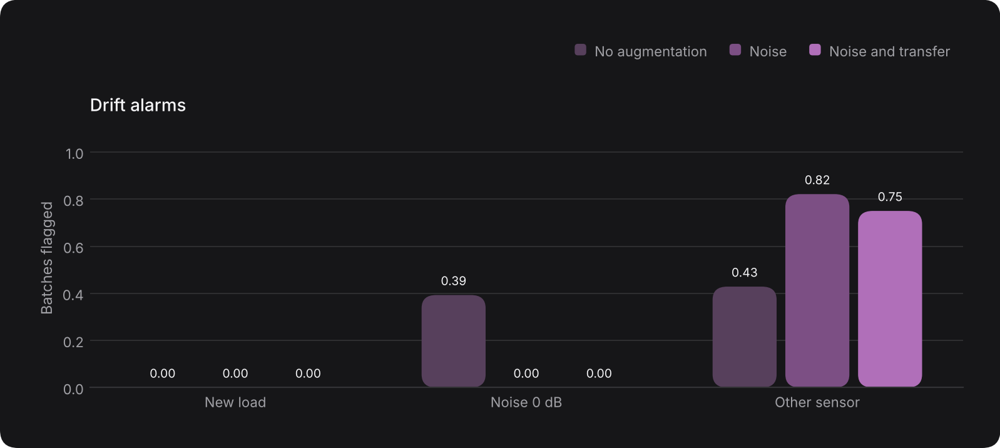
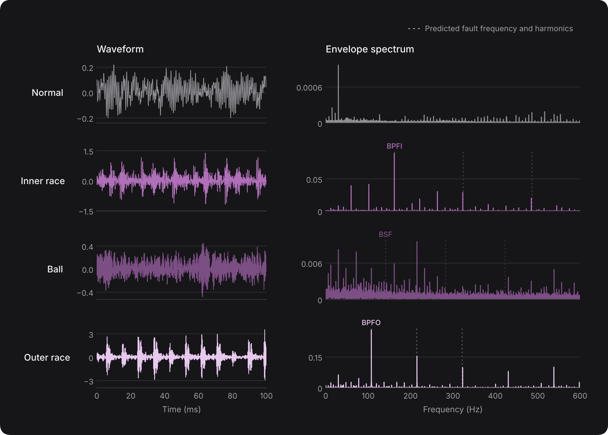

# Machine Condition Intelligence


Machine Condition Intelligence is a compact model that identifies bearing faults from vibration. It reads a short window of accelerometer signal and returns the condition of the bearing. The model is built to stay accurate when the motor load, the noise level or the sensor position changes, adapts to a new sensor without labelled data, and flags input that no longer resembles its training data.

## How It Works


The model reads 2048 samples of acceleration, about 0.17 seconds recorded at 12 kHz, and first normalises them to zero mean and unit variance so that it responds to the shape of the signal rather than its level. Because this step is part of the model, the exported file needs no separate preprocessing.

A bearing fault announces itself as a train of small impacts, each one striking the bearing as a rolling element passes the defect and ringing in a band of frequencies. The first layer of the model is a wide convolution, 64 samples long with a stride of 8, that learns 16 frequency filters directly from the raw signal and so learns which bands carry those impacts. Three convolution blocks, each with batch normalisation, ReLU and max pooling, then combine the filtered signals into 64 channels that respond to the patterns of impacts over time. Pooling averages each channel across the window, so a fault is recognised wherever it occurs, and a linear layer turns the resulting 64 values into a score for each of the four conditions. The highest score is the prediction. The whole model has 21,604 parameters.

## How It Performs

The model is tested only on recordings it has not seen, under each change separately, and scored with macro-F1 across the four conditions. A baseline of ten hand-crafted vibration features with gradient-boosted trees, the approach an experienced vibration engineer would take, is shown for reference alongside three versions of the model that differ only in how they were trained. The released model is the one trained with noise and transfer.


<sub>**Load shift and noise.** Left, macro-F1 when the model is tested at a motor load it was not trained on, after training on three loads or on a single load. Every version of the model reaches 1.00, while the baseline falls to 0.92 when trained on one load. Right, macro-F1 as noise is added to the test signal, from a signal-to-noise ratio of 20 dB down to −5 dB, where the noise is stronger than the vibration itself. The baseline falls to 0.40 and the model trained without augmentation to 0.60, while both versions trained with noise stay at 0.99 or above.</sub>

The released model is exported as an 8-bit file that makes the same decision as the full 32-bit model on 100% of drive-end windows and 98.8% of fan-end windows.

## How It Adapts

A sensor mounted elsewhere on the machine hears the same bearing through a different path, which changes the levels the model was calibrated for. The model adapts by re-estimating the statistics of its batch-normalisation layers from unlabelled windows recorded at the new position, a method known as AdaBN. No labels are needed and no weights are retrained. To know when adaptation is needed, the model also watches its own input. Each batch of 32 windows is compared with the training data using the 64 pooled values, and an alarm is raised when the difference exceeds the level that 99% of training batches stay below.


<sub>**A new sensor position.** Macro-F1 on the fan-end sensor, which no version saw in training, before and after adaptation. A new position is the hardest change for every approach. Training with noise alone lowers the score to 0.23, because the model learns to rely on detail that the new path removes. Training with noise and transfer reaches 0.69, and adaptation raises it to 0.84.</sub>



<sub>**Drift alarms.** The share of batches flagged as drift under each change. The released model, trained with noise and transfer, raises no alarms for a new load or for noise at 0 dB, both changes it handles well, and flags 75% of batches from the unseen sensor, which is the change that calls for adaptation. The model trained without augmentation also flags 39% of noisy batches, since noise is a change it cannot handle.</sub>

## How It Was Trained

The model is trained on sixteen recordings from the [Case Western Reserve University bearing dataset](https://engineering.case.edu/bearingdatacenter): four bearing conditions at four motor loads from 0 to 3 hp, each recorded by a drive-end and a fan-end accelerometer. The faults are 0.007 inch across and sit in the drive-end bearing. Each recording is trimmed to 10 seconds and cut into windows that overlap by 75% for training. Every split holds out whole recordings, so no recording is used for both training and testing.

In each epoch, about half of the training windows receive white noise at a random signal-to-noise ratio between 20 dB and −5 dB, and a random filter that simulates the path vibration takes to a sensor mounted elsewhere. Training runs for 15 epochs with AdamW, a learning rate of 0.001 and a batch size of 64. The released model is trained on all drive-end recordings.



<sub>**What the model learns from.** Left, 100 ms of drive-end vibration for each condition at 0 hp. Right, the envelope spectrum of each signal, which reveals how often the fault impacts repeat. Each fault produces a peak at its own frequency, set by the bearing's geometry and the shaft speed (BPFI for the inner race, BSF for the ball and BPFO for the outer race), with dashed lines marking the predicted frequency and its harmonics. The peaks fall where the physics predicts, which confirms the labels before any training.</sub>


<sub>**How the model is tested.** Each panel is one test fold. Every recording at one motor load is held out for testing, shown in colour, and the model is trained on the other three loads, shown in grey. Holding out whole recordings keeps near-identical windows from the same recording out of both sides of the split.</sub>

## How to Use It

The model is released in `models/` as two ONNX files: `model.onnx` at full 32-bit precision (88 KB) and `model-int8.onnx` at 8-bit precision (41 KB), which classifies a window in 0.02 ms on a single CPU thread. Running it needs only NumPy and ONNX Runtime. The model card, `models/model.json`, records the training data, settings and evaluation.

### Installation

```bash
python3 -m venv .venv && source .venv/bin/activate
pip install numpy scipy matplotlib scikit-learn torch onnx onnxruntime pytest
```

### Classifying a Window

```python
from pathlib import Path
from src.deployment.inference import Classifier

classifier = Classifier(Path("models"))
condition, confidence = classifier(window)  # 2048 samples at 12 kHz
```

### Reproducing the Model

```bash
python -m src.acquisition.fetch          # download the recordings
python -m src.run convolution-transfer   # evaluate under each change
python -m src.deployment.release         # train, export and verify the model
python -m pytest -q                      # run the tests
```

## Limitations

- Trained on one bearing type, one test rig and one fault size.
- Strong coloured noise reduces inner-race recall, since training noise is white.
- At a new sensor position, predictions are reliable only after adaptation.

## License

The code is released under the MIT License. The data belongs to the Case Western Reserve University Bearing Data Center and is not redistributed.
