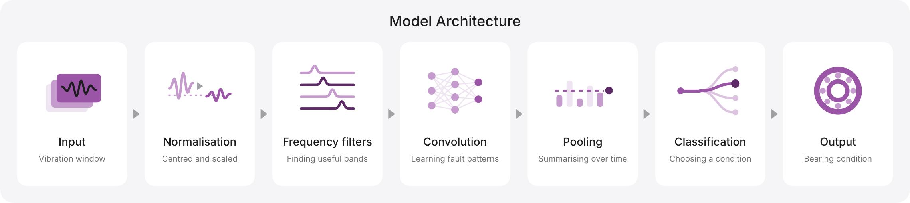
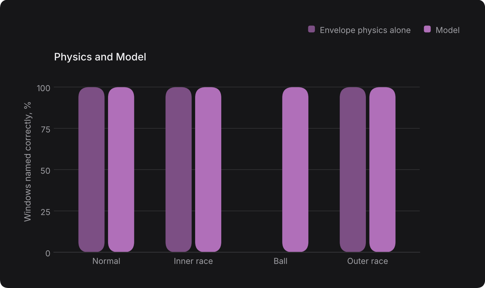

# Machine Condition Intelligence


Machine Condition Intelligence is a compact model that identifies bearing faults from vibration. It reads a short window of accelerometer signal and returns the condition of the bearing. The model is built to stay accurate when the motor load, the noise level or the sensor position changes, adapts to a new sensor without labelled data, and flags input that no longer resembles its training data. Its decisions are checked against the bearing's physics: envelope demodulation at the fault frequencies set by the bearing's geometry agrees with the model on every normal, inner-race and outer-race window, and the model carries the ball faults that the envelope cannot see.

## How It Works



**Input.** The model reads 2048 samples of acceleration, about 0.17 seconds recorded at 12 kHz by a sensor on the motor housing. That is long enough to contain many fault impacts at every motor speed in the data.

**Normalisation.** Each window is shifted to zero mean and scaled to unit variance, so the model responds to the shape of the signal rather than its level. Because this step is part of the model, the exported file needs no separate preprocessing.

**Frequency filters.** A bearing fault produces a train of small impacts that ring in a band of frequencies. The first layer, a wide convolution 64 samples long with a stride of 8, learns 16 frequency filters that pick out the bands carrying those impacts.

**Convolution.** Three convolution blocks, each with batch normalisation, ReLU and max pooling, combine the filtered signals into 64 channels. Together they respond to how the impacts repeat over time, which is what tells one fault from another.

**Pooling.** Pooling averages each channel across the window, giving 64 values that describe which patterns are present. A fault is recognised wherever it falls within the window.

**Classification.** A linear layer turns the 64 values into a score for each of the four conditions. This final layer completes a model of 21,604 parameters.

**Output.** The scores are converted into probabilities, and the condition with the highest probability is the prediction, whether normal or an inner-race, ball or outer-race fault. Its probability is returned with it as the model's confidence.

## The Physics

A defect on a rolling-element bearing is struck once each time a ball passes over it, so its impacts repeat at a rate set by the bearing's geometry and the shaft speed $f_r$. For the drive-end bearing, an SKF 6205 with $n = 9$ balls of diameter $d = 0.3126$ in on a pitch diameter $D = 1.537$ in and no contact angle,

$$\mathrm{BPFO} = \frac{n}{2}\left(1 - \frac{d}{D}\right) f_r = 3.585\, f_r, \qquad \mathrm{BPFI} = \frac{n}{2}\left(1 + \frac{d}{D}\right) f_r = 5.415\, f_r$$

$$\mathrm{BSF} = \frac{D}{2d}\left(1 - \frac{d^2}{D^2}\right) f_r = 2.357\, f_r$$

for an outer-race defect, an inner-race defect and a ball defect. A ball defect strikes both races on each spin, so it repeats at twice its spin frequency, $4.714\, f_r$. At 1797 rpm these are 107, 162 and 141 Hz.

Each impact is brief, and what the accelerometer records is the structure ringing at its resonance, a few kilohertz, once per impact. The fault frequency lives in how often that ringing starts, not in the ringing itself. Band-passing the signal around the resonance (2 to 5 kHz), taking its envelope with the Hilbert transform and reading the envelope's spectrum recovers the impact rate. This is envelope demodulation, and `src/features/envelope.py` implements it.

**Physics checks the model.** For every window, `src/evaluation/physics.py` reads the envelope spectrum at each fault frequency and its first three harmonics, against the spectrum's noise floor. Physics names the fault whose peaks stand at least four times above the floor, or calls the bearing normal. No training is involved.

<p>
<picture>
  
</picture>
<br>
<sub><b>Physics and model.</b> The share of drive-end windows, across all four loads, whose condition is named correctly by envelope physics alone and by the released model. Physics and the model agree on every normal, inner-race and outer-race window. On ball-fault windows the envelope shows no peak at twice the ball spin frequency, only about 1.3 times its noise floor, and physics calls the bearing normal. The model still names them, from what else the ball defect does to the signal.</sub>
</p>

Ball faults in this dataset are known to be hard to see by envelope analysis (Smith and Randall, *Mechanical Systems and Signal Processing*, 2015). Here that is where the learned model earns its place: physics confirms its decisions wherever physics can see, and the model carries the one case physics cannot.

## How It Performs

The model is tested only on recordings it has not seen, under each change separately, and scored with macro-F1 across the four conditions. A baseline of ten hand-crafted vibration features with gradient-boosted trees, the approach an experienced vibration engineer would take, is shown for reference alongside three versions of the model that differ only in how they were trained. The released model is the one trained with noise and transfer.

<p>
  
  <br>
  <sub><b>Load shift and noise.</b> Left, macro-F1 when the model is tested at a motor load it was not trained on, after training on three loads or on a single load. Every version of the model reaches 1.00, while the baseline falls to 0.92 when trained on one load. Right, macro-F1 as noise is added to the test signal, from a signal-to-noise ratio of 20 dB down to −5 dB, where the noise is stronger than the vibration itself. The baseline falls to 0.40 and the model trained without augmentation to 0.60, while both versions trained with noise stay at 0.99 or above.</sub>
</p>

*The released model, exported as an 8-bit file, makes the same decision as the full 32-bit model on 100% of drive-end windows and 98.8% of fan-end windows.*

## How It Adapts

A sensor mounted elsewhere on the machine hears the same bearing through a different path, which changes the levels the model was calibrated for. The model adapts by re-estimating the statistics of its batch-normalisation layers from unlabelled windows recorded at the new position, a method known as AdaBN. No labels are needed and no weights are retrained. To know when adaptation is needed, the model also watches its own input. Each batch of 32 windows is compared with the training data using the 64 pooled values, and an alarm is raised when the difference exceeds the level that 99% of training batches stay below.

<p>
  
  <br>
  <sub><b>A new sensor position.</b> Macro-F1 on the fan-end sensor, which no version saw in training, before and after adaptation. A new position is the hardest change for every approach. Training with noise alone lowers the score to 0.23, because the model learns to rely on detail that the new path removes. Training with noise and transfer reaches 0.69, and adaptation raises it to 0.84.</sub>
</p>

<br>

<p>
  
  <br>
  <sub><b>Drift alarms.</b> The share of batches flagged as drift under each change. The released model, trained with noise and transfer, raises no alarms for a new load or for noise at 0 dB, both changes it handles well, and flags 75% of batches from the unseen sensor, which is the change that calls for adaptation. The model trained without augmentation also flags 39% of noisy batches, since noise is a change it cannot handle.</sub>
</p>

## How It Was Trained

The model is trained on sixteen recordings from the [Case Western Reserve University bearing dataset](https://engineering.case.edu/bearingdatacenter): four bearing conditions at four motor loads from 0 to 3 hp, each recorded by a drive-end and a fan-end accelerometer. The faults are 0.007 inch across and sit in the drive-end bearing. Each recording is trimmed to 10 seconds and cut into windows that overlap by 75% for training. Every split holds out whole recordings, so no recording is used for both training and testing.

In each epoch, about half of the training windows receive white noise at a random signal-to-noise ratio between 20 dB and −5 dB, and a random filter that simulates the path vibration takes to a sensor mounted elsewhere. Training runs for 15 epochs with AdamW, a learning rate of 0.001 and a batch size of 64. The released model is trained on all drive-end recordings.

<p>
  
  <br>
  <sub><b>What the model learns from.</b> Left, 100 ms of drive-end vibration for each condition at 0 hp. Right, the envelope spectrum of each signal, which reveals how often the fault impacts repeat. Each fault produces a peak at its own frequency, set by the bearing's geometry and the shaft speed (BPFI for the inner race, BSF for the ball and BPFO for the outer race), with dashed lines marking the predicted frequency and its harmonics. The peaks fall where the physics predicts, which confirms the labels before any training.</sub>
</p>

<br>

<p>
  
  <br>
  <sub><b>How the model is tested.</b> Each panel is one test fold. Every recording at one motor load is held out for testing, shown in colour, and the model is trained on the other three loads, shown in grey. Holding out whole recordings keeps near-identical windows from the same recording out of both sides of the split.</sub>
</p>

## How to Use It

The model is released in `models/` as two ONNX files: `model.onnx` at full 32-bit precision (88 KB) and `model-int8.onnx` at 8-bit precision (41 KB), which classifies a window in 0.02 ms on a single CPU thread. Running it needs only NumPy and ONNX Runtime. The model card, `models/model.json`, records the training data, settings and evaluation.

### Installation

```bash
python3 -m venv .venv && source .venv/bin/activate
pip install numpy scipy matplotlib scikit-learn torch onnx onnxruntime pytest
```

### Classifying a Window

```python
from pathlib import Path
from src.deployment.inference import Classifier

classifier = Classifier(Path("models"))
condition, confidence = classifier(window)  # 2048 samples at 12 kHz
```

### Reproducing the Model

```bash
python -m src.acquisition.fetch          # download the recordings
python -m src.run convolution-transfer   # evaluate under each change
python -m src.deployment.release         # train, export and verify the model
python -m pytest -q                      # run the tests
```

## Limitations

- Trained on one bearing type, one test rig and one fault size.
- Strong coloured noise reduces inner-race recall, since training noise is white.
- At a new sensor position, predictions are reliable only after adaptation.

## License

The code is released under the MIT License. The data belongs to the Case Western Reserve University Bearing Data Center and is not redistributed.

## Author

Abdirazak Mubarak, November 2026
