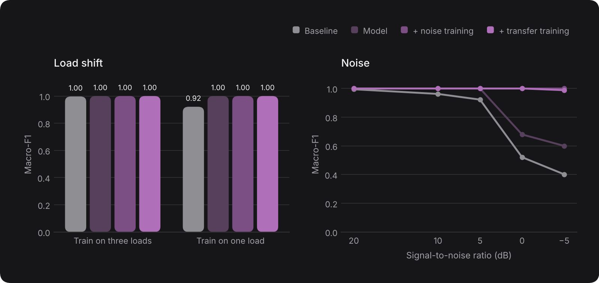
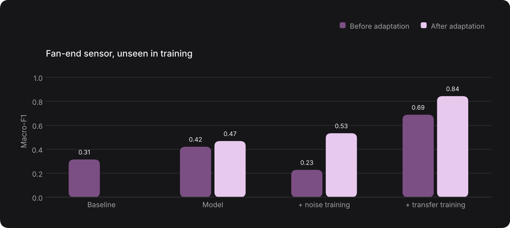

# Machine Condition Intelligence

A compact model that identifies bearing faults from vibration signals.

## Overview

The model reads a 2048-sample vibration window, 0.17 seconds recorded at 12 kHz, and classifies the bearing as normal or as having an inner-race, ball or outer-race fault. It is evaluated under three changes that occur in practice: a different motor load, measurement noise and a different sensor position. It adapts to a new sensor without labels, detects when its input drifts from the training data, and runs as a 41 KB ONNX file.

## How it works


**Input.** A window of 2048 acceleration samples from an accelerometer on the motor housing.

**Normalisation.** Each window is shifted to zero mean and scaled to unit variance. The model responds to the shape of the signal rather than its level, and because this step is part of the model, the exported file needs no separate preprocessing.

**Frequency filters.** A wide first convolution, with a kernel of 64 samples and a stride of 8, learns 16 frequency filters directly from the raw signal. Bearing faults produce repeated impacts that excite specific frequency bands, and these filters learn which bands carry that information.

**Convolution.** Three convolution blocks, each with batch normalisation, ReLU and max pooling, combine the filtered signals into 64 channels that respond to fault patterns over time.

**Pooling.** Each channel is averaged over the length of the window, giving 64 values. The result describes which patterns are present, regardless of where in the window they occur.

**Classification.** A linear layer maps the 64 values to a score for each of the four conditions.

**Output.** The condition with the highest score, together with its confidence.

The model has 21,604 parameters.

## Data

The model is trained and tested on sixteen recordings from the [Case Western Reserve University bearing dataset](https://engineering.case.edu/bearingdatacenter): four conditions at four motor loads (0 to 3 hp). Each recording has a drive-end and a fan-end accelerometer sampled at 12 kHz. The faults are 0.007 inch across and located in the drive-end bearing. Only these files are downloaded, and each is verified by checksum.

Each recording is trimmed to 10 seconds and cut into windows. Training windows overlap by 75% and test windows do not overlap. Every split holds out whole recordings, so no recording contributes to both training and testing.

## Training

The model is trained for 15 epochs with AdamW, a learning rate of 0.001 and a batch size of 64. Each epoch, about half of the training windows are augmented in two ways.

- **Noise.** White noise is added at a random signal-to-noise ratio between 20 dB and −5 dB.
- **Transfer path.** A random smooth equaliser followed by a low-pass filter simulates the different path vibration travels to a sensor mounted elsewhere.

## Results

Each change is tested separately and scored with macro-F1 across the four conditions. The model is compared with a baseline of ten hand-crafted features (six signal statistics and four envelope-spectrum fault-band energies) classified by gradient-boosted trees.

| Evaluation | Baseline | Model | + noise training | + transfer training |
|---|---|---|---|---|
| New load (trained on three) | 1.00 | 1.00 | 1.00 | 1.00 |
| New loads (trained on one) | 0.92 | 1.00 | 1.00 | 1.00 |
| Noise at 0 dB | 0.52 | 0.68 | 1.00 | 1.00 |
| Noise at −5 dB | 0.40 | 0.60 | 1.00 | 0.99 |
| Unseen sensor | 0.31 | 0.42 | 0.23 | 0.69 |
| Unseen sensor, adapted | | 0.47 | 0.53 | **0.84** |

Load results average four folds. Sensor results average four folds and three seeds.



- **Load.** Changing the load has little effect on this dataset. The baseline already reaches 1.00 when trained on three loads.
- **Noise.** The baseline falls to 0.40 at −5 dB. With noise training, the model holds 0.99 or above.
- **Sensor position.** Moving to the fan-end sensor is the largest change. With transfer training and adaptation, the model reaches 0.84, compared with 0.31 for the baseline.

## Adaptation and drift detection



**Adaptation.** At a new sensor, the model re-estimates its batch-normalisation statistics from unlabelled windows recorded there (AdaBN). No weights are retrained.

**Drift detection.** Each batch of 32 windows is compared with the training data using the 64 pooled values. An alarm is raised when the difference exceeds the level that 99% of training batches stay below. The final model raised no alarms for a new load or for noise at 0 dB, and flagged 75% of batches from the unseen sensor.

## Deployment

The released model is trained on all drive-end data, exported to ONNX and quantised to 8-bit integers. The normalisation step is kept in full precision.

| File | Size | Time per window | Same decision as PyTorch |
|---|---|---|---|
| `model.onnx` | 88 KB | 0.05 ms | 100% |
| `model-int8.onnx` | 41 KB | 0.02 ms | 100% drive end, 98.8% fan end |

Times are measured on a single CPU thread. The model card is in `models/model.json`.

## Usage

```bash
python3 -m venv .venv && source .venv/bin/activate
pip install numpy scipy matplotlib scikit-learn torch onnx onnxruntime pytest

python -m src.acquisition.fetch          # download the recordings
python -m src.run convolution-transfer   # evaluate the model
python -m src.deployment.release         # train, export and verify the model
python -m pytest -q                      # run the tests
```

Inference requires only NumPy and ONNX Runtime.

```python
from pathlib import Path
from src.deployment.inference import Classifier

classifier = Classifier(Path("models"))
condition, confidence = classifier(window)  # 2048 samples at 12 kHz
```

## Repository

```
data/       recordings, downloaded on demand
docs/       architecture diagram
models/     released model and model card
reports/    evaluation results and figures
src/        acquisition, preparation, features, modeling, training,
            evaluation, monitoring, deployment, visualization
tests/      split integrity and export parity
```

## Limitations

- One bearing type on one test rig, and one fault size.
- Noise training uses white noise only. Strong coloured noise reduces inner-race recall.
- Adaptation requires unlabelled data from the new sensor before predictions are reliable.

## License

Code is released under the MIT License. The data belongs to the Case Western Reserve University Bearing Data Center and is not redistributed.
